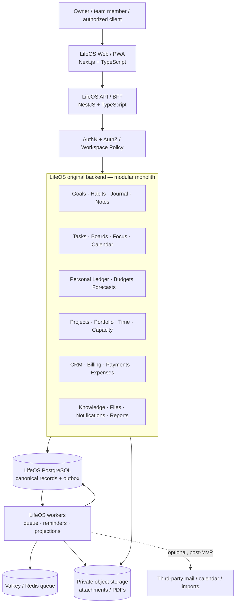
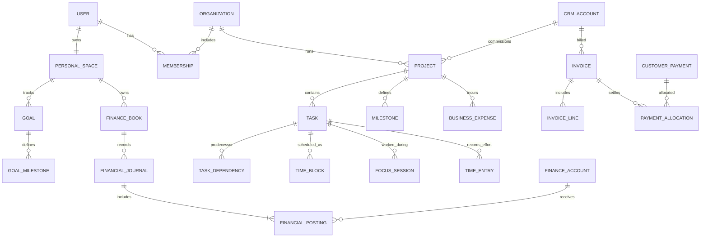

# LifeOS — Independent Personal & Professional Management Platform

> **Document:** `Project.md` — authoritative product requirements and implementation blueprint  
> **Version:** 2.0 — independent application architecture  
> **Status:** Proposed; not implemented  
> **Updated:** 2026-10-13  
> **Product name:** LifeOS (working title)  
> **Deployment priority:** Self-hosted web application and installable PWA; native mobile/desktop clients optional later

---

## 0. Mandatory Scope Clarification — Read First

**LifeOS is a completely new, independent software application.** Firefly III, Kaneo, OpenProject, and Super Productivity are **design research references only**. Their repositories help identify useful features, workflows, domain boundaries, and architectural trade-offs, but they are **not components of LifeOS**.

### Non-negotiable implementation rules

1. **Write LifeOS code from scratch.** No cloning, forking, importing, vendoring, embedding, repackaging, or copying code from the four reference repositories.
2. **Do not deploy or depend on the four reference applications**, their containers, databases, servers, APIs, authentication systems, data models, or clients.
3. **LifeOS owns and persists all core domain data:** tasks, projects, calendars, goals, journal, financial transactions, budgets, time entries, capacity, CRM, invoices, expenses, documents, and analytics source events.
4. Research **capabilities and patterns**, then produce an original domain model, UI, workflow, schema, API contract, and implementation. Do not recreate reference schemas, API shapes, screenshots, UI layouts, or text verbatim.
5. **No integration is necessary** to deliver the core product. Connections to unrelated third-party providers (e.g., calendars, email, banks) are optional future enhancements with well-defined adapters.
6. Keep **personal and business domains inside one LifeOS product**, but separate their security boundaries, accounting books, access rights, and reporting bases.
7. References are for inspiration, **not implementation dependencies**. Their project names may appear in this document's inspiration/decision tables only; no production feature, test, deployment, or definition of done may require them.


### Explicit architectural choice

**One original application; one canonical LifeOS database; one backend codebase with modular domain boundaries; one unified design system; asynchronous workers for long-running jobs.** Start with a modular monolith. Do not build a distributed set of rebranded third-party products.

### Interpret feature references correctly

- **Inspired by** means “learn the user need and product behavior,” **not** “reuse the source.”
- **Native** means designed, implemented, secured, tested, and maintained by LifeOS.
- **Optional provider integration** means a later user-authorized link to an unrelated external service, not to any of the four reference projects.
- **P0** = essential baseline for a module when that module first ships (not necessarily Phase 1); **P1** = its next complete increment; **P2** = advanced/later.

---


## 1. Vision, Goals, and Product Definition


### 1.1 Vision

Create a unified, privacy-conscious application that connects **what a person wants to achieve**, **what they have planned**, **what they actually do**, **how much time and money it takes**, and **what results they obtain** — across their personal and professional life.

LifeOS should support an entire loop:

```text
Capture → Organize → Plan → Schedule → Execute → Track → Review → Improve
           │                                      │
           └──────── Goals / projects / money / people / knowledge ───────┘
```

**Success looks like:** A person can start their day in a single dashboard, manage personal commitments and work tasks, record progress and spending, run a client project, prepare an invoice, and review outcomes without duplicate data entry or switching among unrelated project-management applications.

### 1.2 Users and personas


| Persona            | Primary need                                                     | Visibility                                   |
| ------------------ | ---------------------------------------------------------------- | -------------------------------------------- |
| Personal owner     | Goals, diary, habits, finances, plans and tasks                  | Only their own private personal scope        |
| Solo professional  | Personal planning plus billable projects, customers and invoices | Personal scope plus owned business workspace |
| Business owner     | Portfolio, CRM, finance, delivery, utilization                   | Authorized company-wide summaries            |
| Project manager    | Work plans, assignments, deadlines, risks, approvals             | Assigned project/workspace data              |
| Team member        | Today's work, time entries, documents, comments                  | Assigned/authorized projects and tasks       |
| Finance/operations | Invoices, receipts, budgets, expense approvals                   | Explicit financial roles                     |
| Client/guest (P2)  | Shared progress, accepted deliverables, invoices                 | Explicitly shared subset only                |


### 1.3 Product objectives

- One coherent navigation, one login, one notification inbox, one cross-domain Today view.
- Link goals ↔ milestones ↔ projects ↔ tasks ↔ calendar blocks ↔ time logs ↔ outcomes.
- Support **advanced personal money management** and **commercial business finance**, with separate ledgers, permissions, and measurement conventions.
- Support both lightweight boards and rigorous project delivery without maintaining two incompatible task systems.
- Make business delivery traceable from customer lead through contracted work, capacity, expenses, invoice, and payment.
- Enable individual daily execution and distraction-minimized focus sessions.
- Provide self-hosting, data export, transparent calculations, reliable backups, and fine-grained privacy controls.


### 1.4 Scope, exclusions, and release philosophy

**In scope:** Life areas; goals/habits; personal diary, notes and planner; tasks; project/portfolio management; calendar; personal finance; team time/attendance; staffing/capacity; CRM; quotes/invoices/payments; business expenses/budgets; collaboration/files/knowledge; automation; notifications; analytics.

**Out of scope initially:** Payroll remittance; tax filing; regulated banking execution; brokerage trading; enterprise-grade accounting compliance certifications; clinical records; fully offline multi-user editing; unapproved autonomous AI changes; unrestricted customer portal.

Build in **vertical slices** (domain model → service → API → screen → tests). Avoid delivering dozens of nonfunctional placeholder screens. For P0, narrow the breadth of each module rather than omitting entire core journeys.

### 1.5 Quality principles

- **Original product, no inherited legacy constraints.** Implement coherent entities and UX across modules.
- **Privacy first.** Personal journal and private financial content are never automatically shared with a business workspace.
- **Canonical records.** A task is always a LifeOS task; boards, schedules, work packages and personal lists are views of the same task model.
- **Consistency over duplication.** One project links to CRM, tasks, timesheets and invoices instead of being replicated into other subsystems.
- **Progressive depth.** Simple defaults for an individual; sophisticated controls when operating a team or business.
- **Auditable changes.** Money, approvals, business records, permissions and automation actions have verifiable histories.
- **Accessible and responsive.** Keyboard and mobile access work for daily actions; dense desktop views support professional operations.
- **Self-hosted by default.** Users are not compelled to hand over private records to external vendors.

---


## 2. Inspiration Research — No Source Code or Runtime Reuse


| Reference              | Repository                                                                                                           | Product thinking to learn                                                                                               | Original LifeOS implementation                                                                                                          |
| ---------------------- | -------------------------------------------------------------------------------------------------------------------- | ----------------------------------------------------------------------------------------------------------------------- | --------------------------------------------------------------------------------------------------------------------------------------- |
| **Firefly III**        | [https://github.com/firefly-iii/firefly-iii](https://github.com/firefly-iii/firefly-iii)                             | Account and transaction categorization; double-entry principles; budgeting, recurring entries, reporting, savings goals | **Native Personal Finance** service with original ledger, budget engine, account model, transaction API, dashboards and import pipeline |
| **Kaneo**              | [https://github.com/usekaneo/kaneo](https://github.com/usekaneo/kaneo)                                               | Fast task capture; intuitive project boards; backlog, workflow stages, light collaboration                              | **Native Task & Board** service with flexible board views atop a canonical task and project model                                       |
| **OpenProject**        | [https://github.com/opf/openproject](https://github.com/opf/openproject)                                             | Structured planning; milestones, dependencies, Gantt, project portfolios, work effort and costs                         | **Native Project & Portfolio** domain with tasks, hierarchical work items, milestones, scheduling, time/cost links and reporting        |
| **Super Productivity** | [https://github.com/super-productivity/super-productivity](https://github.com/super-productivity/super-productivity) | Day planning, timeboxing, focus modes, timers, prioritization, personal work habits                                     | **Native Daily Execution** experience with unified Today list, schedule blocks, focus timer, interruptions and time logs                |


### 2.1 Features to combine, not apps to combine

- **One task entity:** Personal tasks, work tasks, board cards and project work items share a common identity and lifecycle. Specialized views add properties where relevant.
- **One execution layer:** A focus session can be launched from any permitted task; it can suggest a time entry without automatically equating focus with attendance or billable labor.
- **One calendar layer:** Native events plus task time blocks and authorized workspace events.
- **Two money domains:** Personal accounts/transactions/budgets and business commercial/financial ledgers share mathematical primitives but not default access or books.
- **One reporting platform:** Domain-specific derived metrics, with explicit source, scope, unit, time period, and cash/accrual meaning.


### 2.2 Inspiration research procedure

For each reference: list useful user journeys; create a capability checklist; identify common user problems and trade-offs; write **original** acceptance criteria; compare against LifeOS requirements; implement independently. Treat external documentation as reference material, **not a code template**. Keep separate evidence/notes in `docs/research/` with source links and review dates. Consult legal counsel before any future third-party asset/code incorporation; none is authorized by this specification.

### 2.3 Resulting original module map


| Native LifeOS module          | Main responsibilities                                               | Priority |
| ----------------------------- | ------------------------------------------------------------------- | -------- |
| Identity & Workspaces         | Auth, personal scope, organizations, roles, sessions, access policy | P0       |
| Command Center                | Today, inbox, home widgets, universal search, quick capture         | P0       |
| Tasks & Execution             | Task tree, checklists, boards, dependencies, focus, timers          | P0       |
| Calendar & Planner            | Native events, agenda, recurrences, time blocks, scheduling         | P0       |
| Goals, Habits & Journal       | Life areas, milestones, check-ins, private diary                    | P0/P1    |
| Notes & Knowledge             | Linked notes, document repositories, versioning, permissions        | P0/P1    |
| Personal Finance              | Native accounts, transaction journal, budgets, savings, reports     | P0/P1    |
| Project & Portfolio           | Projects, milestones, roadmaps, Gantt, risks, baselines             | P0/P1    |
| People, Time & Capacity       | Effort, attendance, leave, timesheets, workloads, skills            | P0/P1    |
| CRM                           | Accounts, contacts, leads, opportunities, activities                | P0/P1    |
| Commercial Finance            | Quotes, invoices, payments, expenses, business budgets              | P0/P1    |
| Collaboration & Notifications | Comments, mentions, approvals, automation, alerts                   | P0/P1    |
| Reports & Analytics           | Metrics, charts, exports, forecasts, saved reports                  | P0/P1    |


---


## 3. Information Architecture and Navigation

```text
LifeOS
├── Command Center
│   ├── Home / Overview
│   ├── Today / Daily Planner
│   ├── Inbox / Quick Capture
│   ├── My Tasks / Focus
│   ├── Calendar
│   └── Notifications / Search
├── Personal (private owner scope)
│   ├── Life Areas / Goals / Milestones
│   ├── Habits / Routines / Reviews
│   ├── Diary / Journal
│   ├── Notes / Knowledge
│   ├── Personal Projects / Tasks
│   ├── Finance / Accounts / Transactions
│   ├── Budgets / Savings / Debts / Forecasts
│   └── Personal Analytics
├── Work (active organization/workspace)
│   ├── Portfolio / Projects / Milestones / Timeline
│   ├── Team Boards / Tasks / Workload
│   ├── Time / Attendance / Leave / Capacity
│   ├── CRM / Accounts / Contacts / Pipeline
│   ├── Quotes / Billing / Invoices / Payments
│   ├── Expenses / Vendors / Budgets / Profitability
│   ├── Knowledge / Documents / Meetings
│   └── Reports / Analytics
└── Settings
    ├── Profile / Themes / Timezone / Currency
    ├── Workspaces / Users / Roles / Invitations
    ├── Personal Privacy / Visibility
    ├── Automation / Notifications
    ├── Import / Export / Optional External Connections
    ├── Security / Audit / Backups
    └── Admin / System Health
```


### 3.1 Contexts

- Personal context belongs only to its owner, including when the owner belongs to an organization.
- Work context is explicitly selected by organization/workspace; navigation remembers context.
- `All` is an owner-only **overlay of authorized summaries**, not a permission bypass or a shared workspace.
- The global search engine only returns authorized resources and redacts private fields by default.
- Journal/finance widgets can be hidden or privacy-masked even on the owner's home page.


### 3.2 Home layout

- Time-aware greeting, date, context selector, search, quick capture and notifications.
- Today's agenda, next meetings, top three priorities, due/overdue work, focus session.
- Goal progress, habit completion, recent note, optional journal prompt.
- Personal budget remaining and upcoming bills (mask amounts by default).
- Work delivery: at-risk milestones, blockers, tasks due, pending approvals.
- Business overview (authorized only): pipeline, outstanding receivables, spending, profitability.
- Team capacity and time approval queue, when role permits.
- Customizable widget order, density, visibility, date range and workspace filters.

---


## 4. Functional Requirements — Build Natively

> Every item below is a **LifeOS-owned feature**. P0/P1/P2 indicate the priority **within that module**, not the first whole-product release and not whether a reference project has a feature. All modules share identity, activity events and authorization, but own their domain rules.


### 4.1 Identity, tenants, access and common foundation — P0

- Account registration, verification, secure login/logout, recovery, optional passkeys and MFA.
- Personal private scope (`personal_space`), plus zero or more organizations and teams.
- RBAC with owner/admin/project-manager/member/finance/viewer, supplemented by resource-level checks; privacy rules never depend on a role name alone.
- Workspace invitations, membership lifecycle, teams, project ACLs and data export permissions.
- Consistent entity links for goal↔task, contact↔project, project↔invoice, note↔anything, time entry↔task, expense↔project.
- Native quick capture for task, note, diary, event, expense, lead, work time.
- Record ownership, status, timestamps, provenance, audit metadata, optimistic versions and soft-delete where justified.
- In-app notifications, outbox events, search, attachments, lifecycle hooks and saved views.

**Acceptance:** Organization membership alone never grants access to the member's personal notes, diary or private financial transactions.

### 4.2 Life Areas, Goals, Habits and Reviews — P0/P1

**P0**

- Custom life areas (learning, work, health, relationships, home, money and custom domains).
- Goals with owner, area, metric, baseline, target, start/due date, priority, status and rationale.
- Goal milestones; linked tasks/events/notes/financial targets; check-ins and progress history.
- Habit schedules (daily, weekdays, weekly quota, custom recurrence), completion logs, streaks, missed-day policy.
- Daily/weekly/monthly review templates: wins, blockers, next actions, numeric scorecards.

**P1**

- Nested goals and OKRs, weighted milestones, quarterly/yearly planning and progress forecasts.
- Custom trackers, templates and life balance reports; privacy-preserving trends.

**Acceptance:** A 90-day goal can be decomposed, scheduled, worked on and measured without duplicating its tasks.

### 4.3 Calendar, Planner and Time Blocking — P0/P1

**P0**

- Native personal/work calendars; day/week/month/agenda views; all-day and timed events.
- Recurrence (RFC 5545 concepts), exceptions, attendees (native users initially), locations, timezones and reminders.
- Task time blocks separate from task due date; drag-and-drop scheduling, conflict flags and daily rollover.
- Day planning: top priorities, task estimated duration, buffer time and visual comparison to free time.
- Work schedules, holidays and approved leave can appear as availability blocks without exposing private details.

**P1**

- Calendar share permissions; optional third-party iCalendar/CalDAV/Google/Microsoft connections, gated by user consent and conflict rules.
- Suggest schedule slots but require confirmation for calendar writes; scheduling templates.

**Acceptance:** Rescheduling a focus block must not change a task's contractual due date; all recurrence/DST transitions are testable.

### 4.4 Private Journal, Notes and Knowledge — P0/P1

**P0**

- Date-indexed private journal with Markdown/rich text, autosave, attachments, tags, templates and optional mood/reflection fields.
- Notes with collections, tags, backlinks, revisions, embedded task references and scoped full-text search.
- Daily reflection and planning pages; private draft and archived states.
- Workspace/project knowledge articles distinct from private notes, with article-level access checks.
- Export to Markdown, JSON and attachment archives.

**P1**

- Editor templates, graph views, side-by-side revision comparisons, published knowledge spaces.
- Optional end-to-end encryption for particularly sensitive documents only after key-management and cross-device recovery design.

**Acceptance:** No journal content appears in team search, notifications, exports or analytics, even if linked to a work task.

### 4.5 Personal Finance — Native Advanced Money Management — P0/P1/P2

**P0: records and core controls**

- Accounts: checking, savings, cash, credit card, loan, investment valuation (manual initially), asset and liability accounts; opening balances.
- Income, expense, transfer, refund and adjustment transactions using a **native balanced posting journal**.
- Categories, tags, merchants/payees, notes, statements, receipts and transaction splits.
- Recurring bills and income schedules with a generated occurrence review queue (no duplicate posting).
- Monthly/weekly/custom-period budgets with category limits, allocations, spend-to-date and alerts.
- Savings goals/sinking funds and account balances; reports for income vs expense, cash flow and category trends.
- CSV/OFX/QIF import may be staged; CSV with preview, mapping, deduplication and rollback is P0 import baseline.
- Search/filter/export, reversible corrections, reconciliation markers and transaction audit history.

**P1: advanced controls**

- Envelope/zero-based and rolling budgets; carryover policies documented per budget.
- Debt amortization/payoff projections, subscription tracking, emergency-fund runway and net worth snapshots.
- Scenario forecasts (baseline/optimistic/conservative) and date-based expected cash flow.
- Multi-currency valuation and FX rates with explicit source, observation date and rounding policy.
- Budget vs actual drilldowns, anomaly flags, monthly close checklist, reconciliations and duplicate detection.
- Automated classification rules that recommend matches; user review before destructive reclassification.

**P2: extensions**

- Optional financial account aggregators or secure bank file import; investment position analytics without trade execution.
- Advanced forecasting, tax-category exports, receipt extraction with human review.

**Financial rules:**

- **Every posted transaction balances**: sum of debits equals sum of credits in its book and currency (or explicit FX bridge entries).
- Store minor currency units or `NUMERIC(20,6)` plus ISO currency; do not use IEEE floats for financial accounting.
- Exclude internal transfers from income/expense totals; refunds and reversals preserve audit history.
- Separate *posted* journal entries from *draft* scheduled transactions and imported-unreconciled items.
- Balances and category totals are derived from postings; imported transactions have unique fingerprints + explicit user-review exceptions.
- Personal finance books are never joined into an organization's billing ledger or disclosed to its members.

**Acceptance:** A $100 transfer between owned accounts changes each account balance without reporting $100 income or spending. An imported row cannot generate duplicate postings when retried.

### 4.6 Universal Task Management and Daily Execution — P0/P1

**P0**

- **Single canonical** `tasks` **model** used by personal lists, team boards, project work items and Today.
- Title, description, assignee(s) model, owner, priority, status, type, labels, due/start date, estimate, completed timestamp, workspace/visibility and project.
- Parent/subtasks, checklist items, dependencies, attachments, comments, watchers and history.
- Backlog, Today, Upcoming, Overdue, Completed, Board/Kanban and List views; filters and bulk actions.
- Unified capture inbox; recurring task templates and generated task instances with uniqueness guards.
- Day plan and timeboxing with drag-to-calendar, effort estimates and daily carry-forward.
- **Native** focus timer with Pomodoro/short breaks, manual pause/resume and distraction notes.
- A focus session optionally creates a proposed time log. Attendance and billable time remain separate.

**P1**

- Custom workflow states and rules, swimlanes, Eisenhower matrix, advanced keyboard actions, saved filters and smart lists.
- Dependency-aware scheduling and suggested task breakdowns requiring explicit user approval.
- Offline quick-capture queue with deterministic merge rules if PWA storage is enabled.

**Acceptance:** The same task appears consistently across list, board, Today, project and calendar without clones. Completing it changes all those views immediately after the authoritative native transaction.

### 4.7 Project and Portfolio Planning — P0/P1

**P0**

- Personal projects, client projects, internal initiatives, and programs/portfolios as native records.
- Project owner, client, scope, stages, team, target dates, budget summary, progress and custom fields.
- WBS: phases, milestones, hierarchical tasks/work packages, predecessors, estimates and blockers.
- List, Kanban, timeline and Gantt views derived from the same task tables; milestones are typed entities/work items.
- Project health, overdue items, blockers, progress and milestone status; templates and archive.

**P1**

- Baseline schedules, critical path, risk/issue/change registers, approvals, dependencies across projects and portfolio aggregation.
- Release/iteration planning, project forecast, customer progress view under explicit sharing.

**Acceptance:** Milestone completion and project progress can be traced to specific native work items; board changes and Gantt changes update the same records.

### 4.8 Team Workflows and Collaboration — P0/P1

**P0**

- Role-based assignment/reassignment, watchers, mentions, activity feeds and task-level comments.
- Team board workflows and custom statuses mapped to normalized categories (not-started/in-progress/blocked/done/cancelled).
- Backlog grooming, task priorities, blocker reasons, overdue reminders and project-specific permissions.
- Task/activity audit history, attachments and actionable notifications.

**P1**

- Approval checkpoints, SLA/response targets, custom workflow transitions and escalation rules.
- Cross-project dependencies and capacity-aware assignee suggestions (human confirmed).

**Acceptance:** A team member without access to a project cannot discover its tasks through search, dashboards, link previews or websocket notifications.

### 4.9 Time Tracking, Attendance and Timesheets — P0/P1

**Never conflate** `focus_session`**,** `time_entry`**,** `attendance_session` **or** `billable_unit`**.**

**P0**

- Native start/pause/stop timer against a task or project; manual work log with activity, interval, duration and description.
- Separate employee check-in/out, break tracking, shift plans, holidays and leave records.
- Draft → submitted → approved/rejected → locked timesheet lifecycle and immutable approval history.
- Optional `billable` flag on eligible approved time; expense/invoice linkage is a separate step.
- Validate overlapping work intervals and timezone/DST handling; support admin corrections with reason and audit trail.
- Reports for time tracked vs estimated, submitted time, overtime indicators and attendance (permission controlled).

**P1**

- Rate schedules, utilization targets, overtime policy configuration, break compliance rules and export of approved chargeable time.

**Acceptance:** One interruption cannot create duplicate chargeable intervals; changing a completed focus timer does not silently edit approved employee attendance or an issued invoice.

### 4.10 Resource and Capacity Management — P1

- People directory: work status, timezone, team, role, skills, availability, manager and utilization goal.
- Standard working schedules, team holidays, approved leave and optional contractor hours.
- Project allocations by person and time period, using hours/week or percentage; cross-project resource conflicts.
- Available capacity = contracted/scheduled working hours − holidays − approved leave − reserved nonproject obligations.
- Forecast demand from task estimates and allocations, with remaining effort and explicit assumptions.
- Capacity planner/heatmap by team, skill, week, client and project; skill-gap and overload warnings.
- Do not show individual private health information or personal calendar event contents to project managers.

**Acceptance:** A person scheduled for 40 hours with 8 hours of approved leave has at most 32 available hours before other constraints; allocations exceeding that figure are visibly flagged.

### 4.11 CRM and Customer Relationships — P0/P1

**P0**

- Organizations/accounts, people/contacts, leads, opportunities, activities, owners, sources, lifecycle stages, tags and custom fields.
- Contact associations, account hierarchies, notes, meetings, calls and future follow-up reminders.
- Pipeline board with expected deal value, win probability, close date, stage history and next action.
- One explicit workflow to convert a won opportunity into a customer project, not automatic creation on every stage edit.
- Link customer ↔ opportunities ↔ quotes ↔ projects ↔ invoices ↔ documents.
- Duplicate matching, CSV import/export, retention rules and contact communication preferences.

**P1**

- Multiple pipelines, products/services catalog, transparent rule-based lead scoring, campaigns and renewal tracking.
- Sales forecasting, conversions, inactivity alerts and opportunity approval steps.

**Acceptance:** A retry of the opportunity-to-project action cannot create a second project for the same conversion request.

### 4.12 Billing, Invoicing and Accounts Receivable — P0/P1

**P0**

- Customer billing identities, terms, currencies, tax identifiers, address and payment instructions.
- Products/services, line items, units, quantity, unit rate, discounts, tax configuration and rounding.
- Quotes (basic), draft invoices, review/approval, issue, due dates, credit notes, void states and immutable issued snapshots.
- Sequential invoice number by organization and series, reserved **atomically at issue time** and never silently reused.
- Payments and allocations to invoices, partial payments, receipts, outstanding balances and overdue status.
- Link invoice items to approved hours, expense pass-throughs, fixed fees, milestones or products; prevent repeated billing of the same source unit.
- Generate server-side PDFs and allow controlled email delivery; all sending actions logged.
- Accounts-receivable aging report (current/30/60/90+), status history and reminder queue.

**P1**

- Accepted quote → project or invoice flow; retainers, recurring invoices, scheduled reminders and multi-currency billing.
- Expense rebilling, payment plans, partial milestone invoicing, supported accounting exports, localized tax templates.

**Rules:** An issued invoice cannot be edited in place without documented correction; credits/reissues retain full linkage. Payment application is idempotent; invoice totals must reconcile from immutable line snapshots. Tax rules are configuration, not a claim of jurisdictional compliance.

**Acceptance:** Two simultaneous invoice-issue operations cannot get the same invoice number. A payment retry cannot increase paid balance twice.

### 4.13 Business Expense, Budget and Commercial Finance — P0/P1

**P0**

- Business expense capture with vendor, project, date, amount, currency, category, receipt and approval state.
- Reimbursable, billable, paid/pending flags; linked invoices/payments and duplicate warnings.
- Business budgets per workspace/project/cost center: allocated vs committed vs actual vs forecast.
- Approved labor cost from rate schedule × accepted timesheet quantities, with a versioned rate snapshot.
- Project cost tracking, budget thresholds, expense workflow and activity log.
- Record customer payments/receipts and project costs without conflating them with the owner's personal book.

**P1**

- Purchase requests/orders, vendors, recurring bills, reimbursements, accounts payable aging and cost forecast.
- General business cashbook/ledger module as a distinct domain, progressively expanded according to accounting requirements.
- Project margin and profitability, cash-basis versus accrual-basis measures explicitly separated.

**Acceptance:** An approved expense attached to a project is counted once in project cost and once in the business ledger (as a linked accounting posting, not as an additional expense).

### 4.14 Documents, Knowledge Base and Information — P0/P1

**P0**

- Knowledge spaces for personal/workspace/project/client; native Markdown editor and rendering safety.
- Notes/articles with page versions, tags, backlinks, ownership, archive and permission inheritance.
- Object-store attachments with metadata, previews for permitted types, checksums and short-lived access links.
- Project documents, meeting agendas, decisions, meeting minutes and action-item task links.
- Comment/mention threads on native knowledge entities and files; permission-aware global search.

**P1**

- Templates, publication/approval workflow, enhanced full-text indexing, file version history and retention rules.
- Optional external storage provider connections, if explicitly configured and separately authorized.

**Acceptance:** Revoking workspace access also removes its records from search, previews, notifications and file downloads.

### 4.15 Communication, Notification and Automation — P0/P1

**P0**

- In-app notifications for assignments, mentions, due dates, approvals, budgets, bills, invoices and lead follow-ups.
- Notification routing, delivery state, read/acknowledge, quiet hours, per-category preferences and digest mode.
- Rule engine MVP: event trigger → scoped condition → small allowlisted action (e.g., create reminder, send notification).
- Every execution stores correlation ID, initiator, result, idempotency key, retry policy and user-visible history.
- Optional SMTP transactional email through a configured provider; no mandatory cloud mail system.

**P1**

- Approval automations, deadline escalation, rule templates, optional Slack/Teams/email/calendar connections.
- Approval-gated AI suggestions (if implemented) that cannot autonomously change money, send messages or expose private context.

**Acceptance:** Redelivering an event does not generate duplicate reminders or invoices; a deleted account cannot continue receiving private notifications.

### 4.16 Analytics, Dashboards and Reporting — P0/P1

**P0**

- Personal widgets: goal progress, habit trend, task completion, focus vs planned hours, budgets, balances and cash flow.
- Work widgets: project health, milestones, overdue work, logged time and team allocations.
- Commercial widgets: opportunities, weighted pipeline, invoiced amounts, collections, receivables, project expenses, budget variance.
- Date range/context filters, drilldown tables, CSV exports and simple print/PDF reports.
- Every metric specifies **unit, calculation, scope, access rule, timeframe, timezone, accounting basis and data-as-of**.

**P1**

- Saved reports, report builder, charts and scheduled digests; permitted dimensional drilldowns.
- Scenario, pipeline, resource and finance forecasting with recorded assumptions.
- Materialized report views for expensive aggregations; refresh timestamps and rebuild procedures.

**Acceptance:** A user cannot infer private journal, personal financial balances or another client's commercially sensitive numbers from cross-workspace reports, even through aggregate filters.

---


## 5. Native End-to-End Journeys


### J01 — A personal goal turns into actual daily execution

1. Create a goal (`Learn advanced networking`) in a life area, with success metric and deadline.
2. Add milestones and tasks in the **LifeOS** task module.
3. Drag task instances into native calendar focus blocks; compare expected vs available time.
4. Start a LifeOS focus timer, pause for breaks, optionally commit tracked task effort.
5. Complete tasks; goal progress recalculates from explicitly linked metrics/weights.
6. Write a private journal reflection and view weekly progress.


### J02 — Plan a personal budget, record activity and review outcomes

1. Create a personal account, assign starting balance and base currency.
2. Define income categories, spending budgets and upcoming recurring bills.
3. Capture or import transactions; verify matching and category suggestions.
4. Post balanced ledger entries; budget actuals and account balances update.
5. Reconcile against a statement; inspect overspend and upcoming obligations.
6. Create a savings target linked to a life goal; review forecasts without modifying actual postings.


### J03 — Lead to proposal, delivery, billable time and payment

1. Capture a CRM lead; log activities and convert to opportunity/customer account.
2. Create a quote; upon acceptance create a **native LifeOS project** from a template.
3. Plan milestones and assignments using LifeOS boards/Gantt; allocate people/capacity.
4. Team members execute native tasks; approved timesheets generate billable candidates.
5. Review direct costs, linked expenses and contracted milestones.
6. Generate and issue a native invoice; record a customer payment and allocation.
7. Review project margin, outstanding balance, customer activity and retained documents.


### J04 — A unified work/personal daily plan

1. Today view queries authorized private tasks, work assignments and native calendar items.
2. User selects priorities and creates calendar time blocks.
3. A task appears once, even if visible on multiple work boards and the Today timeline.
4. A focused task session tracks effort; clock-in/attendance is a distinct action.
5. End-of-day review separates unfinished actions, work time, personal reflection and reminders.


### J05 — Project capacity planning

1. Define team working schedules, skill sets, holidays and approved leave.
2. Estimate tasks and allocate people to projects/week buckets.
3. Compute availability, utilization and over-allocation.
4. Flag conflicts and suggest reallocation, but do not automatically override assignments.
5. Display forecast versus accepted time and projected completion in project portfolio.


### J06 — A high-trust finance workflow

1. A finance member prepares a draft business invoice.
2. A distinct authorized approver confirms issue, or owner follows a documented solo-business exception.
3. Invoice number is reserved in a database transaction; issued snapshot and outbox event persist atomically.
4. PDF/email dispatch runs asynchronously; a failed email does not roll back the already-issued invoice.
5. Payment is recorded exactly once and allocated; correction uses credit note/reversal, not silent deletion.

---


## 6. Technical Architecture — Entirely Native


### 6.1 Architecture selection

**Preferred architecture: modular monolith with background workers and internal domain events.**

- One original LifeOS API/backend deployment.
- One original LifeOS web/PWA frontend.
- PostgreSQL is LifeOS's sole authoritative relational database, organized into clear domain schemas/modules.
- An object store holds attachments, private receipts, document versions and invoice PDFs.
- A queue/worker handles scheduled and slow operations; cache is disposable.
- No core behavior requires calling Firefly III, Kaneo, OpenProject or Super Productivity.
- Cross-module communication occurs through typed application services and domain events, not circular imports or raw cross-module table writes.




The diagram is conceptual: all domain modules run within the same backend process/deployable unit, while worker processes may run separately using the **same LifeOS source repository**. A domain grouping in this diagram is not an independent upstream application or microservice.

### 6.2 Technology stack — proposed decisions


| Layer              | Recommendation                                                                            | Rationale / boundary                                                                        |
| ------------------ | ----------------------------------------------------------------------------------------- | ------------------------------------------------------------------------------------------- |
| Frontend           | Next.js (React, TypeScript)                                                               | Custom, responsive UI; server rendering when beneficial; PWA for daily use                  |
| UI/design system   | Tailwind CSS, accessible headless primitives, custom components                           | Coherent original interface with keyboard and screen-reader support                         |
| Backend            | NestJS + TypeScript, REST JSON with OpenAPI                                               | Strong module boundaries, DTO validation, documented contracts                              |
| Relational storage | PostgreSQL 16+; Prisma **or** Drizzle, choose one in ADR                                  | ACID transactions, constraints, strong query capabilities                                   |
| Queue/cache        | Valkey/Redis-compatible + BullMQ                                                          | Reminder processing, report generation, email/PDF, retries; never financial source of truth |
| Files              | S3-compatible private bucket (e.g., MinIO in self-hosted mode)                            | Receipts, attachments, previews and exports                                                 |
| Authentication     | Original LifeOS auth using maintained auth libraries, or supported OIDC identity provider | LifeOS sessions, MFA/passkeys and access policy; no DIY cryptographic protocols             |
| Authorization      | Central policy module + SQL/RLS defense in depth where practical                          | Every query/write/download/export checks subject, action and scope                          |
| Search             | PostgreSQL full-text/trigram initially                                                    | Permission-filtered search; separate index only if demonstrably needed                      |
| Realtime           | SSE or authenticated WebSocket gateway                                                    | Task board updates, alerts and timer synchronization                                        |
| Charts             | Accessible chart library                                                                  | Correct, labeled metrics, units and period selection                                        |
| Docs/contracts     | OpenAPI + generated typed client; ADRs and Markdown docs                                  | Explicit long-term contracts                                                                |
| Testing            | Vitest/Jest, Playwright, Testcontainers, accessibility checks                             | Unit/integration/E2E and financial invariant tests                                          |
| Deployment         | Docker Compose initially; Caddy/Traefik reverse proxy                                     | Reproducible local/self-host installation and HTTPS                                         |
| Telemetry          | Structured logs + OpenTelemetry-compatible traces/metrics                                 | Performance visibility without logging private content                                      |


**Avoid premature complexity:** Do not introduce Kafka, Kubernetes, GraphQL, microservices, Elasticsearch or multiple primary databases simply to appear enterprise-grade. Re-evaluate when load measurements or product needs justify them.

### 6.3 Logical module boundaries and allowed dependencies

```text
foundation: identity, organization, policy, audit, attachments, events
                         ↑ (used by all domains)
  personal: goals, habits, journal, private notes
  planning: tasks, projects, calendars, focus
  workforce: attendance, time, leave, capacity
  crm: accounts, contacts, leads, opportunities
  finance-personal: books, journals, budgets, reconciliation
  finance-business: invoices, payment allocations, costs, budgets
  collaboration: knowledge, comments, notifications
  analytics: domain-specific read projections and reports
```

- Modules expose **application-service interfaces**, domain events, and versioned APIs; their internal ORM models are private.
- Cross-module links store typed references (`entity_type`, `entity_id`) only when a direct relational FK is impractical; validate links with the owning module.
- `planning` may request CRM customer identity through a CRM read interface; it may not mutate CRM tables directly.
- `billing` consumes **approved billable time** via a workforce service and **contract/project metadata** via delivery services; it writes its own invoice snapshots.
- `analytics` reads scoped projections, never changes source domain records.
- `notifications` consumes events, checks recipient authorization at delivery, and can be rebuilt from retained events where feasible.
- Cyclic domain calls are disallowed. Use orchestration/application workflows for multistep journeys and events for nonblocking follow-up.


### 6.4 Transactional behavior

- Single-database transactional consistency for related native writes when appropriate.
- Persist domain state **and an outbox row** in one DB transaction; publish to queue after commit.
- Every durable event includes unique event ID, aggregate ID/version, actor, workspace and correlation ID.
- Consumers store processed event IDs, accept at-least-once delivery and use idempotent handlers.
- For cross-domain business workflows, define an orchestrator with explicit intermediate states and compensations; never assume an email send or PDF generation is part of a database transaction.
- Prefer optimistic concurrency (`version` and conditional updates) for collaborative edits.


### 6.5 Authentication and tenancy model

- A user can have one personal space and multiple memberships in organizations.
- `scope_type = PERSONAL | ORGANIZATION`; all nonpublic aggregates belong to exactly one scope.
- Personal space requires `owner_user_id = session.user_id`; organizational resources require active membership **and** a resource permission.
- A global dashboard runs multiple individually authorized queries, then merges results in memory; it is not an unrestricted database query.
- Journal records are `PERSONAL` only unless the user consciously converts a separate copy to an organizational knowledge record.
- Organization-level exports and analytics cannot include personal book data even when the owner is the business administrator.
- Service-to-service and background jobs use minimal, explicitly named scopes and recheck permissions before delivery.


### 6.6 Deployment topology

```text
Internet / LAN
  └── HTTPS reverse proxy
       ├── LifeOS web  (Next.js)
       └── LifeOS API  (NestJS)
             ├── PostgreSQL     [private network, persisted volume]
             ├── Valkey/Redis   [private network, queue/cache]
             ├── Object store   [private, encrypted storage]
             └── LifeOS worker  [same LifeOS codebase, separate process]

Optional later: outbound SMTP, calendar integrations, bank-file import,
identity federation, backups, monitoring endpoint.
```

Separate development, staging and production environments. Use managed secrets; production DB, queue and object storage never expose public unauthenticated ports. PWA offline features use carefully scoped local caches; **private journal/finance data must not be cached casually on shared devices**.

### 6.7 Repository layout — original source only

```text
lifeos/
├── Project.md
├── README.md
├── LICENSE                          # license for original LifeOS source
├── package.json
├── pnpm-workspace.yaml
├── apps/
│   ├── web/                          # original LifeOS UI/PWA
│   ├── api/                          # original NestJS modular backend
│   └── worker/                       # original jobs/schedulers
├── packages/
│   ├── ui/                           # original design tokens/components
│   ├── contracts/                    # validation, OpenAPI DTOs, events
│   ├── shared/                       # utilities, money/time primitives
│   └── config/                       # lint, TS, security policies
├── database/
│   ├── migrations/                   # versioned; review every migration
│   └── seed/                         # synthetic only
├── infra/
│   ├── compose/                      # local/staging/production
│   ├── reverse-proxy/
│   └── observability/
├── docs/
│   ├── architecture/                 # diagrams, data flows, security
│   ├── adr/                          # architectural decision records
│   ├── research/                     # reference comparisons, no copied code
│   ├── api/
│   ├── domain/                       # glossary, state machines, invariants
│   ├── ux/
│   └── runbooks/                     # backup, restore, deployment, incident
└── tests/
    ├── unit/  ├── integration/  ├── e2e/
    ├── security/  ├── accessibility/  └── performance/
```

**Module directory example:** `apps/api/src/modules/{identity,workspaces,policy,goals,habits,journal,notes,calendar,tasks,projects,focus,timesheets,attendance,capacity,crm,personal-finance,business-finance,billing,documents,notifications,automation,analytics,audit}/`. This is a planned collection of separate directories, not a literal path to copy. Create each when its first working vertical slice is implemented.

---


## 7. Canonical Domain and Data Model


### 7.1 Global modeling conventions

- Primary keys: UUIDv7 (or UUIDv4, chosen consistently) generated server-side; all relational FKs are indexed.
- Every record has `created_at`, `updated_at`, `created_by` where applicable; collaborative aggregates have integer `version`.
- Each tenant-scoped aggregate has `scope_type` + `scope_id` or one validated scope FK. Reject records with ambiguous/missing scope.
- Store UTC instants and preserve IANA time zone for local schedule semantics; never use naive timestamps for appointments.
- All monetary amounts use integer minor units where sufficient or fixed-precision decimal with currency; FX conversion is explicit.
- DB-level unique/check constraints cover invoice numbering, transaction balancing, idempotency keys and entity uniqueness.
- Migrations are reversible when feasible, always reviewed for destructive changes, and tested against representative data.
- Do not build a single giant polymorphic `entities` table. Use domain-specific normalized tables and explicit linking tables.
- Store sensitive documents in private encrypted object storage; relational DB stores ownership and immutable content hashes/keys.


### 7.2 Identity and privacy scope


| Table / aggregate                     | Important fields                                    | Invariants                                       |
| ------------------------------------- | --------------------------------------------------- | ------------------------------------------------ |
| `users`                               | id, email, display_name, locale, timezone, status   | Email uniqueness under documented normalization  |
| `personal_spaces`                     | id, owner_user_id                                   | One owner; not a team workspace                  |
| `organizations`                       | id, name, base_currency, owner_user_id, status      | Organization identity distinct from CRM customer |
| `memberships`                         | user_id, organization_id, role, status              | Only active memberships grant org access         |
| `teams`, `team_memberships`           | organization_id, member ids, roles                  | Scoped to one organization                       |
| `roles`, `permissions`, `role_grants` | subject/action/resource grants                      | Server-enforced; deny by default                 |
| `sessions`, `authenticators`          | revocation, assurance level, last used              | Secure token/session storage                     |
| `audit_events`                        | actor, action, scope, resource, reason, correlation | Append-only from ordinary application roles      |


**Personal/organization separation:** `personal_space` is never represented as a special organization that a team admin can join. A universal `ScopeRef` value object resolves either personal owner or organization; application services enforce the type before reading or writing.

### 7.3 Goals, habits, journal, knowledge


| Table                                               | Key columns                                                                              |
| --------------------------------------------------- | ---------------------------------------------------------------------------------------- |
| `life_areas`                                        | personal_space_id, name, order, icon                                                     |
| `goals`                                             | scope_ref, owner_id, area_id?, metric_type, baseline, target, current, timeframe, status |
| `goal_milestones`                                   | goal_id, title, target, weight, status, position                                         |
| `goal_checkins`                                     | goal_id, date, value, reflection, actor                                                  |
| `habits`                                            | personal_space_id, schedule_rule, target_count, unit, rollover_policy                    |
| `habit_checkins`                                    | habit_id, local_date, count, recorded_at, note                                           |
| `journal_entries`                                   | personal_space_id, local_date, encrypted_or_plain_content_ref, privacy_mode, version     |
| `journal_revisions`                                 | journal_entry_id, revision, content_ref, author, timestamp                               |
| `notes`, `note_revisions`                           | scope_ref, title, body_ref, owner, version, tags                                         |
| `knowledge_spaces`, `articles`, `article_revisions` | organization_id, project_id?, ACL, content_ref, version                                  |
| `entity_links`                                      | scope, from_kind/id, to_kind/id, relation_type                                           |


Use explicit relation types: `supports_goal`, `describes_task`, `references_contact`, `belongs_to_project`, `blocks_task`, `billed_by_invoice`, etc. Each link is permission checked **in both directions**.

### 7.4 Tasks, execution and scheduling


| Table                                    | Key columns                                                                                                        | Contract                                              |
| ---------------------------------------- | ------------------------------------------------------------------------------------------------------------------ | ----------------------------------------------------- |
| `projects`                               | id, scope_ref, client_id?, owner_id, status, planned_start/end, baseline_id?                                       | One native project entity                             |
| `project_phases`                         | project_id, parent_phase_id?, title, position                                                                      | Optional WBS grouping                                 |
| `milestones`                             | project_id, title, due_at, progress_policy, achieved_at                                                            | Typed project outcome                                 |
| `tasks`                                  | id, scope_ref, project_id?, phase_id?, parent_task_id?, title, status, priority, due_at, estimate_minutes, version | **One canonical task row**                            |
| `task_assignees`                         | task_id, user_id, assignment_role                                                                                  | One or more assignees; notifications honor membership |
| `task_checklist_items`                   | task_id, text, complete, order                                                                                     | Children of task, not shadow tasks                    |
| `task_dependencies`                      | predecessor_task_id, successor_task_id, kind, lag                                                                  | No cyclic dependencies; same-scope sharing policy     |
| `task_workflow_statuses`                 | scope_ref, project_id?, key, category, sort_order                                                                  | Normalized reporting categories                       |
| `task_recurrences`                       | task_template_id, recurrence_rule, exception_dates, next_due                                                       | Generates distinct occurrence tasks                   |
| `task_occurrences`                       | template_id, occurrence_key, task_id                                                                               | Unique `(template_id, occurrence_key)`                |
| `boards`, `board_columns`, `board_views` | project_id/scope_ref, filters, column mapping, order                                                               | **Views and organization**, not duplicate tasks       |
| `calendar_events`                        | scope_ref, owner, title, start/end, timezone, recurrence, version                                                  | Authoritative native events                           |
| `event_exceptions`                       | parent_event_id, recurrence_instance, overrides                                                                    | Recurrence edits are explicit                         |
| `time_blocks`                            | owner, task_id?, start/end, timezone, status                                                                       | Planning artifact, not worklog                        |
| `focus_sessions`                         | user, task_id?, start/end, paused_seconds, status                                                                  | User execution telemetry                              |
| `focus_interruptions`                    | focus_session_id, timestamp, reason, duration                                                                      | Optional personal metrics                             |


#### State and consistency policies

- Task normalized categories: `NOT_STARTED`, `IN_PROGRESS`, `BLOCKED`, `DONE`, `CANCELLED`; each workspace may define display states mapped to categories.
- Task completion is determined by its status transition (authorized, audited); moving between board columns changes that same task.
- A task can have a due date and many time blocks; scheduled/planned durations are never treated as actual time entries.
- Milestones can have explicit dependencies and links to tasks; projects roll up from defined progress policy, not from arbitrary weighted status names.
- `task_dependencies` must not contain self-edges or cycles; reject at service layer, optionally validate via recursive SQL.
- Focus sessions persist start/stop/paused state server-side for multi-device recovery; browser timer only displays elapsed time.
- Recurring task instances have stable occurrence keys to prevent double-generation after scheduler retries.


### 7.5 Personal accounting schema

The personal finance engine must **use original code with proper financial invariants**, not a superficially categorized transactions table.

```text
personal_finance_books
  ├── finance_accounts
  │     (book_id, parent_id?, type, institution?, currency, status)
  ├── financial_journals
  │     (book_id, event_date, posted_at, state, payee?, memo, source_id?)
  │       └── financial_postings
  │             (journal_id, account_id, direction, amount, currency,
  │              category_id?, clearing_state, dimension_refs)
  ├── finance_categories / merchants / transaction_tags
  ├── budget_plans / budget_periods / budget_allocations
  ├── savings_targets / savings_allocations
  ├── recurring_rules / scheduled_financial_occurrences
  ├── import_batches / import_rows / reconciliation_matches
  ├── fx_rates / valuation_snapshots
  └── financial_adjustments / statement_reconciliations
```

**Posting design:** Choose either signed amounts or debit/credit fields and document a single sign convention. For each posted journal, enforce balance at the domain service **and with a database-enforced transaction/trigger or constrained posting function** before commit. A journal cannot be partially posted. Use immutable posted entries plus reversal/correction journals; drafts can be edited. The application must explicitly model liabilities and credit card balances.

**Categories vs ledger:** Categories represent reporting dimensions for recognized spending/income, while accounts represent actual asset/liability/equity/income/expense postings. Category totals must be computed from the configured expense/income accounts or posting classification and not by summing both sides of a transfer.

**Reconciliation:** `statement_balance` and `cleared_balance` are distinct. Imported records remain staged until matched/posted and reviewed. Idempotency applies by import source + normalized statement row fingerprint + user-confirmed override.

**Currency:** Cross-currency transfers require paired entries plus a rate/rounding bridge or documented equivalent, so each book/currency balances and valuation differences are visible. FX-based net worth is a *derived dated valuation*, not an alteration of historic nominal postings.

### 7.6 Business commercial data model


| Table group      | Tables / key invariants                                                                                         |
| ---------------- | --------------------------------------------------------------------------------------------------------------- |
| CRM              | `crm_accounts`, `crm_contacts`, `crm_leads`, `crm_opportunities`, `crm_stages`, `crm_activities`                |
| Products/quotes  | `products_services`, `price_books`, `quotes`, `quote_lines`, `quote_acceptances`                                |
| Billing          | `invoices`, `invoice_lines`, `invoice_number_series`, `credit_notes`, `invoice_snapshots`, `invoice_deliveries` |
| Receipts         | `customer_payments`, `payment_allocations`, `payment_methods`, `payment_reconciliation`                         |
| Expenses/AP      | `vendors`, `business_expenses`, `expense_receipts`, `expense_approvals`, `purchase_orders`, `vendor_bills`      |
| Project cost     | `project_budget_versions`, `project_budget_lines`, `cost_entries`, `billable_units`, `contract_rates`           |
| Finance books P1 | `business_books`, `business_accounts`, `business_journals`, `business_postings`, `business_periods`             |


**Mandatory relationships and constraints:**

- `crm_account` is a customer/vendor identity; `organization` is the LifeOS tenant. They are not the same entity.
- `projects.client_account_id` points to a customer in the same organization.
- Invoices belong to one organization, customer, currency and number series; issued invoice header and lines are immutable snapshots.
- `UNIQUE(organization_id, series_id, invoice_number)`; number assignment uses a locked counter row or equivalent atomic database operation.
- `payment_allocations` cannot exceed unallocated confirmed receipt amount or invoice outstanding amount under the configured overpayment policy.
- Every `billable_unit` has a source (`time_entry`, `expense`, `milestone`, `product`) and unique billing linkage; prevent double billing at the database level.
- Project costs can be derived from approved time + approved expenses + purchase commitments, but each cost fact has exactly one cost identity.
- Cash received, invoiced amount, revenue recognized and gross margin are **different measures** and must remain distinct.
- When P1 business general-ledger accounting is enabled, post accounting transactions with idempotent links from invoices, payments and expenses; do not count the commercial record and its ledger postings as two financial events.


### 7.7 Workforce data model

- `people_resources(id, organization_id, user_id?, display_name, employment_type, start/end, status)`.
- `resource_skills`, `resource_skill_levels`, `work_calendars`, `work_calendar_exceptions`.
- `leave_requests`, `leave_approvals`, `resource_allocations`.
- `attendance_sessions` and `attendance_breaks` (presence/time on shift).
- `time_entries` (task/project effort); `timesheets`, `timesheet_lines`, `timesheet_approvals`.
- `billable_units` (commercial billing eligibility with frozen quantity/rate provenance).
- Separate policy for correction, overlapping intervals, approvals, timesheet locks and approved expenses.

**Policy example:** A 9:00–17:00 shift with 60-minute unpaid break results in 7 hours attendance. One or more 50-minute focus sessions are neither proof of attendance nor automatically billable. An approved 3-hour project time entry can become a 3-hour billable unit if the contract and billing policy permit it.

### 7.8 Shared platform tables

`attachments`, `attachment_versions`, `comments`, `mentions`, `notifications`, `notification_receipts`, `automation_rules`, `automation_runs`, `domain_events_outbox`, `event_inbox_dedup`, `scheduled_jobs`, `saved_views`, `report_definitions`, `report_snapshots`, `export_jobs`, `import_batches`, `audit_events`, `entity_links`.

Restrict each shared object with ownership/scope resolution; a generic `entity_type + entity_id` combination is **not** sufficient authorization proof.

### 7.9 Representative entity relationship diagram




**Caution:** This is an illustrative domain graph. Implement explicit scope constraints and all junction tables in actual schema migrations; do not infer implementation-ready DDL from the diagram alone.

---


## 8. API, Internal Events, and Background Processing


### 8.1 API rules

- REST JSON under `/api/v1`; OpenAPI is generated from checked-in contracts and validated in CI.
- Authorize at API boundary **and** domain service; never trust a browser-submitted `owner_id` or `organization_id`.
- IDs are opaque; access checks prevent enumeration or IDOR.
- Use cursor pagination for high-volume lists; filters validated and bounded; stable sort guarantees.
- Use `Idempotency-Key` on potentially duplicated POST operations (financial postings, invoice issue, payment, import job, recurrence generation).
- Use `If-Match`/version for concurrent task edits, notes, calendars and approvals.
- Structured errors: stable `code`, human message, correlation ID, field errors; never include secrets or database traces.
- UTC ISO 8601 timestamps plus explicit IANA timezone where necessary; money as decimal **strings** in JSON plus currency code.
- No “module API” endpoint should return a personal diary field in organization-context responses.


### 8.2 Proposed core endpoint inventory (original LifeOS API)

```http
# Authentication / workspaces
GET    /api/v1/me
GET    /api/v1/workspaces
POST   /api/v1/workspaces
POST   /api/v1/workspaces/{id}/invites

# Unified command center
GET    /api/v1/home?scope=...&localDate=...
GET    /api/v1/today?scope=...&localDate=...
GET    /api/v1/search?q=...&scope=...

# Native tasks / focus
GET    /api/v1/tasks?scope=...&view=...&cursor=...
POST   /api/v1/tasks
PATCH  /api/v1/tasks/{taskId}
POST   /api/v1/tasks/{taskId}/complete
POST   /api/v1/tasks/{taskId}/subtasks
GET    /api/v1/boards/{boardId}
POST   /api/v1/focus-sessions
POST   /api/v1/focus-sessions/{id}/pause
POST   /api/v1/focus-sessions/{id}/finish

# Personal planning / records
POST   /api/v1/goals
POST   /api/v1/goals/{id}/checkins
POST   /api/v1/habits/{id}/checkins
GET    /api/v1/calendar/events?from=...&to=...
POST   /api/v1/calendar/events
POST   /api/v1/calendar/time-blocks
POST   /api/v1/journal/entries
POST   /api/v1/notes

# Native personal finances
GET    /api/v1/personal-finance/books/{bookId}/balances
POST   /api/v1/personal-finance/journals/drafts
POST   /api/v1/personal-finance/journals/{id}/post
POST   /api/v1/personal-finance/journals/{id}/reverse
POST   /api/v1/personal-finance/imports
GET    /api/v1/personal-finance/budgets/{id}/performance

# Project / people
POST   /api/v1/projects
GET    /api/v1/projects/{id}/timeline
POST   /api/v1/time-entries
POST   /api/v1/timesheets/{id}/submit
POST   /api/v1/timesheets/{id}/approve
POST   /api/v1/attendance/check-in
POST   /api/v1/attendance/check-out
GET    /api/v1/capacity?organizationId=...&week=...

# CRM / commercial
POST   /api/v1/crm/opportunities
POST   /api/v1/crm/opportunities/{id}/convert
POST   /api/v1/billing/quotes
POST   /api/v1/billing/invoices
POST   /api/v1/billing/invoices/{id}/issue
POST   /api/v1/billing/payments
POST   /api/v1/billing/payments/{id}/allocate
POST   /api/v1/business-expenses

# Knowledge / automation / analytics
POST   /api/v1/documents
POST   /api/v1/articles
GET    /api/v1/notifications
POST   /api/v1/automations
GET    /api/v1/reports/{id}
POST   /api/v1/reports/{id}/exports
```

All paths are **proposed endpoints to implement**, not existing software APIs. Document request/response DTO, permissions, side effects, errors and idempotency for every implemented route.

### 8.3 Example typed domain events

```ts
type DomainEvent<TPayload> = {
  eventId: string;
  eventName: string;             // e.g., "task.completed"
  eventVersion: number;
  aggregateId: string;
  aggregateVersion: number;
  scope: { type: 'PERSONAL' | 'ORGANIZATION'; id: string };
  actorId: string | null;
  occurredAt: string;            // ISO 8601 UTC
  correlationId: string;
  causationId?: string;
  payload: TPayload;             // minimal, no diary text or secrets
};
```

Initial events: `task.created`, `task.completed`, `task.assigned`, `goal.checkin_recorded`, `calendar.block_changed`, `focus.session_finished`, `finance.journal_posted`, `finance.budget_threshold_reached`, `timesheet.submitted`, `timesheet.approved`, `crm.opportunity_won`, `invoice.issued`, `payment.allocated`, `expense.approved`, `resource.overallocated`, `document.shared`, `notification.created`.

**Every consumer must tolerate event replay and out-of-order deliveries** based on aggregate version; automated financial postings need additional ledger-side idempotency constraints.

### 8.4 Internal worker jobs


| Job                     | Trigger                 | Safety / idempotency                                           |
| ----------------------- | ----------------------- | -------------------------------------------------------------- |
| Recurrence expansion    | Scheduled               | Unique occurrence key; skip already created instance           |
| Due-date notification   | Rule/event/time         | Unique recipient/event/rule key; quiet hours                   |
| Budget threshold check  | Ledger posting          | Recompute on journal state; no double alert                    |
| Reminder/digest         | Queue/schedule          | Per-user time zone and preference                              |
| PDF invoice             | Issuance event          | Immutable invoice snapshot; content hash/version               |
| Invoice email           | User approval or policy | Delivery record and idempotent external request when possible  |
| Rebuild reports         | Domain event/nightly    | Rebuildable, never authoritative                               |
| Attachment scan/preview | Upload complete         | Quarantine until checks pass                                   |
| CSV import processor    | Accepted upload         | Stage → map → preview → commit; rollback/reverse policy        |
| Data export             | Explicit user action    | Scope checks before enqueue and at delivery; expiring download |
| Backup check            | Operations schedule     | Alert on last successful backup/restore test                   |


### 8.5 Extensibility without dependency on inspiration projects

Only after core functions work, define original `Connector` ports for **unrelated** calendar, email, storage or banking providers. Constrain credentials/scopes, rate limits, sync checkpoint, consent and conflict handling. Optional connectors must be removable with no impact on LifeOS canonical tasks, project records or financial postings. Do not write or ship adapters to any of the four design reference projects as a core milestone.

---


## 9. UX, Design System, and Interaction Architecture


### 9.1 Navigation and hierarchy

- Collapsible left navigation; context selector, global search/command palette and persistent quick capture.
- Desktop main workspace with toolbars, dense tables, split-pane detail views and filter sidebar.
- Mobile bottom/compact navigation prioritizing Today, tasks, calendar, capture and notifications.
- Every view indicates scope (private/work), date range, permissions and current filter.
- Fast back navigation and cross-links from goal/project/customer/invoice/task without losing the user's place.


### 9.2 Native screen catalog


| Area           | Required screens                                                                     |
| -------------- | ------------------------------------------------------------------------------------ |
| Foundation     | Onboarding, login, MFA, organization selector, members/roles, profile                |
| Command Center | Dashboard, Today, My Tasks, Inbox, search, notifications                             |
| Personal       | Goals, goal detail, habit tracker, journal, notes, personal finances, budget planner |
| Tasks          | Task list, Kanban board, task detail, focus timer, task templates                    |
| Calendar       | Day/week/month/agenda, timeblock editor, recurrence editor                           |
| Work delivery  | Project portfolio, project overview, timeline/Gantt, milestone view, risks           |
| Workforce      | Time entry, timesheets, approvals, attendance, leave, capacity planner               |
| CRM            | Organizations, contacts, lead inbox, opportunity pipeline, account detail            |
| Finance        | Quote editor, invoice builder, payment entry, expenses, budget review, reports       |
| Documents      | File browser, knowledge article, versions, permissions, meeting notes                |
| Admin          | Audit, automation rules, export/import, operational health, backup status            |


### 9.3 Design requirements

- Original coherent visual language; no imitated screenshots, logo treatments or UI design from reference software.
- Clear information hierarchy, readable typography, limited accent palette, neutral surfaces and robust light/dark themes.
- High density where data-heavy (CRM, time, finance), generous whitespace where reflective (diary, goals).
- Minimal distraction focus screen; accessible state colors always paired with labels/icons.
- Proper empty, loading, permission-denied, disconnected/failed job, overdue and conflict states.
- Screen-reader support and keyboard-first workflow; WCAG 2.2 AA design target.
- Provide alternatives to drag-and-drop, semantic form validation and reduced-motion compatibility.
- Charts show axes, dates, units, filters and clear interpretation; never blend currencies without conversion.
- Default privacy mask for sensitive financial tiles and journal previews when multiple contexts are visible.


### 9.4 UX components to build

`AppShell`, `ScopeSwitcher`, `QuickCapture`, `CommandPalette`, `TaskRow`, `TaskDetailDrawer`, `KanbanBoard`, `GanttTimeline`, `CalendarGrid`, `TimeBlockCard`, `FocusTimer`, `GoalProgressCard`, `BudgetProgress`, `MoneyAmount`, `AccountBalance`, `InvoiceEditor`, `ApprovalStepper`, `ContactRecord`, `CapacityHeatmap`, `DocumentViewer`, `NotificationCenter`, `AuditHistory`.

Define states, keyboard behavior and permission behavior for each component. Do not create duplicate task editors or project form implementations for personal and work contexts when a shared control plus domain policy is sufficient.

---


## 10. Security, Privacy, and Compliance-by-Design


### 10.1 Threat model and sensitive data

Protected assets include diaries, contact records, client documents, bank balances, personal financial entries, employee attendance, customer invoices, API tokens and audit history. Primary threats: cross-tenant IDOR, broken object-level authorization, leaked backups, malicious uploads, stored XSS in Markdown, session hijack, financial operation replay, malicious automation rules, privilege escalation, race conditions, and unauthorized analytics inference.

### 10.2 Mandatory controls before real data

- HTTPS/TLS, secure HTTP-only session cookies, CSRF protection, strict CORS/CSP, input validation, output encoding, safe redirect and upload constraints.
- Strong password hashing via maintained libraries (or external OIDC), MFA for administrators and finance approvers, passkeys optional.
- Enforce access policy in backend services and DB queries; systematically test personal-vs-business scope isolation.
- Encrypt sensitive storage, object store and backups at rest; rotate/manage keys, never embed keys in source or browser code.
- Audit financial postings, invoice issue/void, time approval, access grants, exports, payment allocations and exceptional admin actions.
- Signed, short-lived attachment URLs only after authorization; malware scanning/quarantine and content-type verification.
- Financial state changes use idempotency and transactional locks; corrections are reversible/traceable.
- Rate limit sensitive endpoints; redact personal finance/journal content from telemetry and error traces.
- Dependency scanning, SBOM, container signing where feasible, pinned versions and secret scanning in CI.
- Least-privilege DB/queue/storage users; never publish DB or queue services to the internet.
- Use synthetic fixture data in tests and demos. No real private data in logs, screenshots, support tickets or staging.


### 10.3 Privacy classification and data lifecycle


| Classification        | Examples                                    | Default controls                                         |
| --------------------- | ------------------------------------------- | -------------------------------------------------------- |
| Public                | Explicit marketing page                     | Optional public rendering                                |
| Workspace internal    | Team tasks, shared articles                 | Membership + ACL                                         |
| Confidential business | Client files, bids, invoices, vendor prices | Specific role/resource permissions, enhanced audit       |
| Personal sensitive    | Diary, personal book, private notes         | Only personal owner, excluded from shared search/reports |
| Employment sensitive  | Attendance, leave reasons, pay rates        | HR/manager role restrictions; minimum necessary fields   |


- User exports are scoped; sensitive export archives require short-lived access and encryption where appropriate.
- Deletion and retention differ across modules. Accounting records may require reversal, archival and retention rather than immediate physical deletion.
- Define legal and privacy compliance obligations for actual deployment jurisdictions. This plan does **not** claim HIPAA, GDPR, PCI DSS, SOC 2 or bookkeeping certification.
- Optional AI features default to **off** for private finances, diary and customer documents; sending data to any AI provider requires informed, scoped consent.


### 10.4 Security release gates

- No critical/high known exploitable security issues in production dependencies without documented exception.
- Automated multi-tenant authorization tests, private search and attachments tests, XSS/CSRF/SSRF tests and race-condition tests for finance issuance.
- Dependency update and secret rotation runbooks tested.
- Account lockout/rate-limit behavior, session revocation and backup encryption verified.

---


## 11. Reliability, Performance, and Operations


### 11.1 Operational requirements

- Health/readiness endpoints for API, worker, DB, queue and object storage.
- Structured logs with request/correlation IDs and redaction; traced background jobs.
- Safe schema migrations and seeded local environments; app readiness after migration checks.
- Durable queue with exponential-backoff retries and dead-letter handling; clear job failure/status UI.
- Database transactions for financial/accounting issuance, project conversion and approval transitions.
- Encrypted database snapshots and object storage backups with offsite copy and documented key recovery.
- Restore drill before production; test database + file state consistency as a combined recovery unit.


### 11.2 Targets (initial design objectives, verify on target hardware)


| Property               | Initial objective                                            | Measurement                           |
| ---------------------- | ------------------------------------------------------------ | ------------------------------------- |
| Home load              | p95 under 3 seconds with normal warm data                    | Browser E2E, representative workspace |
| Routine API query      | p95 under 500 ms at expected concurrent load                 | Server performance suite              |
| Task status visibility | Under 2 seconds for collaborators on same online workspace   | Realtime/integration tests            |
| Financial correctness  | Zero unbalanced posted journals or duplicated invoice number | DB constraints + property tests       |
| Backup recovery point  | RPO ≤ 24h initial self-host target                           | Monitored backup success              |
| Recovery time          | RTO ≤ 8h initial self-host target                            | Restore drill evidence                |
| Accessibility          | WCAG 2.2 AA target for core flows                            | Automated + manual checks             |


**Capacity assumptions to validate:** single self-host deployment supporting 1–20 users initially; data fixture: 100,000 tasks, 100,000 finance postings, 10,000 contacts, 1,000 projects, 50,000 time entries. Benchmarks should demonstrate pagination, correct indexes, bounded reports and absence of N+1 API patterns.

### 11.3 Backups and restore

1. Versioned encrypted PostgreSQL backup/point-in-time strategy as deployment tier supports.
2. Encrypted object storage + file/version manifest backup at consistent checkpoint.
3. Record app/DB migration version, secrets/key custody and restore instructions.
4. Automatic backup failure notifications and routine restore-to-isolated-environment tests.
5. Explicit recovery sequence: stop writes → restore DB/files → verify migrations and outbox → reconcile report projections → resume services.
6. Never treat browser cache, worker queue or report projections as the durable source of records.

---


## 12. Phased Implementation Plan and Delivery Backlog

These phases describe **dependency order, not promises of fixed completion dates**. Each phase must produce a demonstrable application capability, migrations, tests and documentation. The broad specification is intentionally larger than the Phase 1 MVP. A P0 feature means the baseline required **when its particular module launches**, not that every module ships in Phase 1; ship a usable subset without faking unfinished features.

### Phase 0 — Product contract, architecture and prototypes

**Deliverables**

- [x] Ratify Section 0: independent application, no copied code or runtime reliance on reference products.
- [x] Define product identity, target operating systems/browser support, self-hosted deployment assumptions and user roles.
- [x] Select PostgreSQL, ORM (Prisma *or* Drizzle), NestJS auth approach, job queue and object storage; record ADRs.
- [x] Define personal scope vs organizations and RBAC/action matrix; run threat-model workshop.
- [x] Design domain glossary: task/work package, project, milestone, event/time block, focus/time/attendance, personal finance journal and business commercial record.
- [x] Define UX sitemap, Figma/wireframe prototypes, accessible component tokens and responsive navigation.
- [x] Define canonical task workflow, journal posting invariants and invoice state machines.
- [x] Draft ERDs and OpenAPI for first vertical slices; review index and data retention policies.
- [x] Define architecture acceptance tests, performance fixture targets, logging and backup design.
- [x] Create source tree, package manager/workspaces, formatter/linter, CI, container-based local environment.

**Exit gate:** Build and boot an empty authenticated LifeOS application with a working database migration, health endpoint and meaningful end-to-end login/scope test. No third-party reference application installed.

### Phase 1 — Foundation + original Today / Tasks (first usable MVP)

**Backend / data**

- [ ] Identity, sessions, personal space, organizations, invitations and policy engine.
- [ ] Native task/task-assignee/checklist/dependency models, task application service, audit records.
- [ ] Native calendar events and time blocks, with local time-zone handling.
- [ ] Outbox, notifications, minimal scheduled jobs, attachment metadata and permission-aware quick search.

**UI / workflows**

- [ ] Onboarding, context switcher, app shell, command palette and quick capture.
- [ ] Today screen showing authorized tasks and native calendar events.
- [ ] Create/edit/complete tasks, checklist, list view, minimal board view and task detail.
- [ ] Add/edit time blocks; display conflicts and today's estimated workload.
- [ ] Focus start/pause/finish and daily review summary (minimal).

**Tests / exit gate**

- [ ] Personal and work tasks cannot leak across scopes; board and Today refer to the **same task ID**.
- [ ] Task update concurrency tests, recurrence/date edge cases, basic accessibility and E2E coverage pass.
- [ ] A sole owner can plan and execute a real week without any other product.


### Phase 2 — Personal Life System + Finance Foundation

**Life planning**

- [ ] Life areas, measurable goals, goal/task links, progress check-ins.
- [ ] Habit recurrence, check-ins, simple streaks, scheduled reminders.
- [ ] Private journal with autosave/export and private notes with backlinks.
- [ ] Home cards showing goals, habits, completed tasks and today's plan.

**Personal money engine**

- [ ] Original personal finance book, typed accounts and balanced postings.
- [ ] Income/expense/transfer/refund journal workflows and safe reversals.
- [ ] Account balances, reporting categories, basic monthly budgets, savings targets.
- [ ] CSV preview/import, deduplication, manual match and transaction audit history.
- [ ] Spending dashboards and basic monthly review.

**Exit gate:** Can create a goal, do a habit, write a private journal, record and reconcile a budgeted month of transactions, and verify balanced books. Organization members cannot read any private data.

### Phase 3 — Projects, Team Work and Resource Operations

- [ ] Native work project, milestones, WBS, backlog, Kanban and timeline/Gantt.
- [ ] Project templates, task relationships, assignees, status and progress rollups.
- [ ] Collaboration: comments, mentions, attachments and project activity.
- [ ] Native task timers, work time entries, attendance and breaks (independent records).
- [ ] Timesheet submission/approval with locks and audit trails.
- [ ] Working schedules, leave, capacity assignments and overload warnings.
- [ ] Portfolio view with milestones due, project health, team utilization and work reports.

**Exit gate:** A team can plan a project, assign tasks, track progress and effort, approve timesheets and inspect workload — all inside LifeOS.

### Phase 4 — CRM, Quotes, Billing and Business Expense Operations

- [ ] CRM accounts/contacts/leads/opportunities/pipeline and history.
- [ ] Account/opportunity → project conversion with explicit idempotent workflow.
- [ ] Products/services, pricing, quote creation and acceptance tracking.
- [ ] Native invoice editor, approval/issue state, atomic numbering and PDF snapshots.
- [ ] Payment collection recording/allocations, credit notes, receivables report.
- [ ] Business expenses/vendors/receipts, approval flow, project budget/cost views.
- [ ] Approved billable time → invoice candidate flow with nonduplication constraint.
- [ ] Organization-level commercial dashboard with source-defined accounting measures.

**Exit gate:** Demo a lead → accepted quote → project → approved time → issued invoice → partial/full payment, with complete audit, correct scoped access and no duplicate billable units.

### Phase 5 — Knowledge, Reporting, Automation and Advanced Finance

- [ ] Full native document/knowledge manager, article revisions, permission-safe search.
- [ ] Advanced personal budgets, subscriptions, debt/goal projections, scenario cash-flow tools.
- [ ] Budget variance, resource forecast, project profitability and portfolio risk/issue registers.
- [ ] Configurable dashboards and saved/report definitions with CSV/PDF export.
- [ ] Rule automation with approval gates, execution logs and retry/dead-letter handling.
- [ ] Scheduled financial reminders, recurring invoice support, retention controls and backup UX.
- [ ] Optional external SMTP/calendar/bank file connectors — **not required for any core record**.

**Exit gate:** Cross-module reports reconcile to their canonical native records; privacy, recovery and automation safety checks pass.

### Phase 6 — Product Hardening and Optional Extensions

- [ ] Improve offline capture and conflict management where feasible; quantify cross-device requirements.
- [ ] Dedicated mobile/desktop shell if PWA is insufficient; native device integrations by explicit user consent.
- [ ] Client portal, deeper approval automations, advanced budgeting and business accounting only after domain review.
- [ ] Improve scalability/observability with measured evidence; add caching/read replicas only if necessary.
- [ ] Penetration testing, privacy impact review, usability research and production runbooks.

**Exit gate:** Release readiness, documented migration/backups, incident procedures, monitoring and hardening checklist completed.

### 12.1 Priority-ordered epics for issue tracking


| ID         | Epic                           | Earliest phase | Primary acceptance                          |
| ---------- | ------------------------------ | -------------- | ------------------------------------------- |
| CORE-01    | Identity and scope policy      | 1              | Private/workspace data isolation verified   |
| CORE-02    | Shared UI and API conventions  | 1              | Accessible shell and typed API              |
| TASK-01    | Native task service            | 1              | One task appears in all matching views      |
| PLAN-01    | Calendar and time blocks       | 1              | Scheduling does not mutate due date         |
| FOCUS-01   | Daily execution                | 1              | Pause/resume/daily summaries reliable       |
| GOAL-01    | Life areas and goals           | 2              | Progress traceable to linked activity       |
| HABIT-01   | Habit check-ins                | 2              | Accurate recurring schedule/streaks         |
| JOURNAL-01 | Private diary/notes            | 2              | Owner-only, searchable/exportable privately |
| FIN-P01    | Personal native ledger         | 2              | Balanced posting/reversal invariant         |
| FIN-P02    | Budgets, import and reports    | 2              | Import/retry deduplication                  |
| WORK-01    | Projects and WBS               | 3              | List/board/Gantt share one model            |
| WORK-02    | Time, attendance, approvals    | 3              | Distinct records, immutable approvals       |
| WORK-03    | Resource capacity              | 3              | Availability math and conflict flags        |
| CRM-01     | Accounts and pipeline          | 4              | Idempotent opportunity conversion           |
| BILL-01    | Invoice lifecycle              | 4              | Atomic numbering/immutable issued PDF       |
| BILL-02    | Receipts and allocations       | 4              | No duplicate/over-allocations               |
| COST-01    | Expense and project cost       | 4              | No duplicate cost recognition               |
| DOC-01     | Knowledge/files                | 5              | Scoped permissions in download/search       |
| AUTO-01    | Notification/automation engine | 5              | Idempotent safe actions                     |
| DATA-01    | Reports and forecasting        | 5              | Reproducible documented metrics             |
| OPS-01     | Backup/restore/security        | All            | Tested restore and security gates           |


### 12.2 First ten implementation tickets (concrete sequence)

1. **T001:** Initialize pnpm monorepo; TypeScript configs, lint, format, unit tests and CI. *Done:* clean install, builds and tests locally.
2. **T002:** Local Compose for Postgres, queue, storage, API and UI with persisted volumes. *Done:* one documented boot path and health checks.
3. **T003:** Authentication/session vertical slice. *Done:* login/logout, protected route, session rotation tests.
4. **T004:** Personal scope/org membership and authorization guard. *Done:* cross-tenant deny tests.
5. **T005:** Canonical task migration and service. *Done:* create/list/update/status/audit through API.
6. **T006:** Task list/detail UI with quick capture. *Done:* responsive, keyboard accessible E2E.
7. **T007:** Board view bound to the same tasks. *Done:* board transition updates list without cloning.
8. **T008:** Calendar event/time-block model and week/Today screen. *Done:* timezones and conflict checks.
9. **T009:** Focus timer server session with interruption/pause. *Done:* reload does not lose active timer state.
10. **T010:** Backup baseline, metrics, error boundaries and smoke suite. *Done:* full restored environment passes login/task/calendar smoke test.

---


## 13. Testing and Acceptance Strategy


### 13.1 Minimum automated test suites

- **Domain unit tests:** task lifecycle, date math, recurrence, goal progress, budget rules, FX, ledger balancing, invoice rounding, resource capacity, overtime policies.
- **Property tests:** randomly generated balanced journals, sums/rounding, invoice line totals, retries, payment allocation limits, dependency-cycle rejection.
- **Database integration tests:** unique constraints, isolation of tenant-scoped queries, transaction rollback, concurrent invoice number allocation, idempotency keys.
- **API contract tests:** OpenAPI schemas, auth errors, cross-scope denial, validation, pagination, timezones, immutability.
- **UI E2E:** onboarding, quick capture, focus, calendar, journal, financial entry, project planning, timesheet approval and invoice issuance.
- **Security tests:** IDOR, file preview/download authorization, search leakage, XSS-in-Markdown, CSRF, rate limits, access revocation, privilege escalation.
- **Accessibility:** automated axe-style checks plus manual keyboard/screen-reader testing for primary workflows.
- **Performance:** 95th percentile dashboard/API under representative fixture size; time and memory caps for report queries.
- **Recovery:** restore Postgres + object storage + app secrets, replay or reconcile outbox/projections and verify ledger totals.


### 13.2 Cross-cutting invariants (must always hold)

1. Every private record has a valid authorized owner/scope; organizational roles cannot read personal books or journal.
2. Task `id` stays identical across Today, boards, project views, calendars and reports.
3. A task's scheduled focus block is not its due date, tracked time, or attendance record.
4. Posted personal financial journals balance; reversing a journal preserves audit evidence.
5. Imported transactions and scheduled occurrences remain idempotent under retries.
6. Approved timesheets are locked; billable units are unique and traceable.
7. An issued invoice gets exactly one number and immutable snapshot; numbers do not collide under concurrency.
8. Payment allocations cannot exceed policy limits or be duplicated.
9. Resource allocations do not magically increase capacity; overbookings are reported.
10. All asynchronous actions are auditable with correlation IDs and safe replay behavior.
11. Report data is derived from authorized canonical records; never bypass permission checks using caches.
12. The application remains functional when internet connectivity to third-party services is absent, except explicitly optional features.


### 13.3 Functional acceptance scenarios


| Scenario                                       | Expected result                                                         |
| ---------------------------------------------- | ----------------------------------------------------------------------- |
| Owner completes task in Today                  | Native Kanban, project and list show same completed task                |
| User edits future time block                   | Task deadline and historical time entry remain unchanged                |
| Team admin searches owner's diary              | No existence, snippet, result count or file leak                        |
| Personal account A transfers $100 to account B | Correct balances, no false income/expense                               |
| Import process retries same CSV                | Same set of accepted journal postings, no duplicates                    |
| Two invoice issue requests race                | Two unique invoice numbers or one idempotent issuance, never collision  |
| Worker fails after saving invoice              | Invoice remains issued; PDF/email job can safely retry                  |
| Timesheet approver rejects submission          | Correct state, history and permitted editing paths                      |
| Team member loses project permission           | Immediate deny for API, attachment, search, report and realtime channel |
| Owner restores backup in clean environment     | Ledger, tasks, documents and audit trail reconcile                      |


### 13.4 Definition of Done for a feature

A feature is complete only if it has: approved design/contract; secure DB migration; validated domain rules; service and API; accessible responsive UI; permission checks; activity/audit behavior where relevant; automated tests; reasonable metrics/errors/empty states; documentation; and a demonstrable acceptance scenario. Do not label a page complete because it renders mock cards.

---


## 14. Architectural Decisions, Risks, and Mitigations


### 14.1 Accepted decisions


| Decision ID | Choice                                     | Reason                                                                          |
| ----------- | ------------------------------------------ | ------------------------------------------------------------------------------- |
| ADR-001     | Independent greenfield app                 | Consistent design and full ownership; no inherited deployment or API dependency |
| ADR-002     | Modular monolith first                     | Strong domain boundaries without premature distributed consistency complexity   |
| ADR-003     | Canonical native task model                | Avoid two/three conflicting task sources and synchronization loops              |
| ADR-004     | Personal vs organization scope segregation | Required for private life + shared business in one product                      |
| ADR-005     | Native personal financial posting journal  | Advanced money management needs sound invariants, not a transaction spreadsheet |
| ADR-006     | Separate business financial domain         | Avoid personal/business fund mixing and false metric semantics                  |
| ADR-007     | Transactional outbox for derived events    | Reliable notifications/projections while retaining ACID core writes             |
| ADR-008     | Native calendar + time-block distinction   | Preserve scheduling, deadlines, attendance and effort as separate facts         |
| ADR-009     | Optional external connectors later         | Core LifeOS must operate on its own                                             |


### 14.2 Risk register


| Risk                                           | Impact                                         | Mitigation                                                                   |
| ---------------------------------------------- | ---------------------------------------------- | ---------------------------------------------------------------------------- |
| Trying to implement all modules simultaneously | Unshippable, unstable app                      | Phased vertical slices and realistic P0 minimum                              |
| Complex finance rules implemented incorrectly  | Incorrect balances and trust failure           | Ledger invariants, test vectors, reversals and expert review                 |
| Cross-tenant/private data leakage              | Severe privacy and business risk               | Explicit scopes, centralized policy, object and report tests                 |
| Bloated task/project data models               | Hard to maintain, inconsistent views           | Canonical task aggregate, board as view, stable enums/contracts              |
| Invoice/payment race conditions                | Duplicate numbers, incorrect receivables       | DB locks/unique constraints, idempotency and audit snapshots                 |
| Calendar/timezone/recurrence bugs              | Missed events and faulty deadlines             | Zoned test cases, DST edge tests and recurrence libraries                    |
| Ambiguous accounting metrics                   | Misleading business decisions                  | Document cash/accrual and recognized vs received measures                    |
| Sensitive information leaks through AI/search  | Privacy breach                                 | Opt-in only, scope-aware index, redaction and audit                          |
| Performance slows with large histories         | Unusable dashboards                            | Indexed queries, cursor pages, materialized reporting views                  |
| Frequent production schema changes             | Broken migration/recovery                      | Staged migrations, backups, compatibility tests                              |
| UX becomes overcrowded                         | Low everyday adoption                          | Progressive disclosure, role/context views, user testing                     |
| Imitating reference UI/code too closely        | Intellectual-property and maintenance concerns | Original UX, clean implementation, original schema/API, research attribution |


### 14.3 Open design questions to record before their implementation phase

- Should standalone personal projects be a type of `project` or a private task list with project-like metadata? **Recommended:** same `projects` model with personal scope.
- Is multi-assignee task completion per task or per assignee? **Recommended:** one shared task completion state; assign personal checklist/acceptance records if individual completion is needed.
- What is the correct progress model for a milestone and parent task? **Recommended:** explicitly chosen rollup policy, not implicit average of subtasks.
- Should the personal finance book be cash-only or include liabilities and valuation adjustments from the start? **Recommended:** type-safe account classification from P0; advanced valuations P1.
- How will business accounting expand beyond invoices/expenses? **Recommended:** define accounting boundary and mapping now; introduce full business journal module only after domain review.
- Which tax/financial jurisdictions need compliant document layouts? **Recommended:** generic configurable invoice output until actual target requirements are established.
- Is deployment for one user, one organization, or SaaS multi-tenant hosting? **Recommended:** single instance supporting multiple scoped organizations without assuming a public SaaS business model.
- How should sensitive journal encryption affect search and device recovery? **Recommended:** normal strong server encryption baseline; optional end-to-end encryption later with explicit trade-offs.

---


## 15. Rules for Developers and Coding Agents

1. **Treat this** `Project.md` **as the primary architecture and product contract.** Resolve contradictions with ADRs before making architecture-changing commits.
2. **Do not reuse or integrate the code, APIs, databases, Docker services or runtime systems** of the four research references. They exist only to inform requirements and patterns.
3. **Create original UX**; do not clone upstream CSS, components, layouts, icons, data structures, test fixtures or screenshots. Maintain research attribution links as required.
4. Implement small **complete vertical slices**: schema → domain invariant → application service → HTTP contract → UI → automated tests → docs.
5. Never make React client state the authoritative source of a task, invoice, payment or time-entry state.
6. Do not implement business rules, role permissions, financial totals or invoice numbering in UI components; place them in backend domain services and enforced DB constraints.
7. Do not create multiple task tables for personal board, work board, calendar planner and focus. Use one canonical task model with specialized relationships/views.
8. Do not conflate personal financial accounts with business customer receivables or invoices. Show separate scopes, books and reports.
9. Every finance write needs amount/currency validation, immutable history, transactional consistency and idempotency; never edit posted ledger rows in place.
10. Every sensitive resource read/write, export, search, websocket message or file access must pass **server-side** scope and object permission checks.
11. Use maintained packages for authentication/crypto, timezone handling, recurrence and PDF generation; **do not** invent cryptographic algorithms or depend on upstream app implementations.
12. Use typed DTOs, versioned endpoints, input validation, cursor paging and consistent errors; write contract tests.
13. Domain events carry minimal metadata, not private diary text or banking secrets. Consumers must handle retries safely.
14. Queue failures must not corrupt source state. Distinguish `queued`, `attempting`, `completed`, `failed`, `needs_review` where appropriate.
15. Do not ship placeholders as completed scope; use feature flags for genuinely unfinished modules and update phase checklist accurately.
16. Document and test migrations, backup/restore, key management, environment variables and production upgrades.
17. Be deliberate with accessibility, responsive layouts and privacy masking; avoid generic dashboard components that obscure core workflows.
18. Keep source modules separate by bounded context, no circular imports, no raw cross-module mutation of another module's private tables.
19. Any external provider API introduced later must be optional, consented to, scoped and removable without losing LifeOS core data.
20. Maintain `docs/adr/`, `docs/domain/`, `docs/api/`, `docs/research/` and verified acceptance criteria as the implementation evolves.

---


## 16. Verification and Reference Resources

These references are for **feature/architecture research only**. Do not treat a repository license as permission to claim ownership of its source code, UI assets, branding or copied content.

- Firefly III (finance behavior and bookkeeping concepts): [https://github.com/firefly-iii/firefly-iii](https://github.com/firefly-iii/firefly-iii) — [https://docs.firefly-iii.org/](https://docs.firefly-iii.org/)
- Kaneo (simple project boards and task workflows): [https://github.com/usekaneo/kaneo](https://github.com/usekaneo/kaneo) — [https://kaneo.app/docs/](https://kaneo.app/docs/)
- OpenProject (structured work/project and portfolio planning): [https://github.com/opf/openproject](https://github.com/opf/openproject) — [https://www.openproject.org/docs/](https://www.openproject.org/docs/)
- Super Productivity (day planning, timeboxing and focus): [https://github.com/super-productivity/super-productivity](https://github.com/super-productivity/super-productivity) — [https://super-productivity.com/](https://super-productivity.com/)
- OAuth 2.0 / OIDC specifications (only if identity federation is adopted): [https://openid.net/developers/specs/](https://openid.net/developers/specs/)
- OWASP Application Security Verification Standard and guidance: [https://owasp.org/www-project-application-security-verification-standard/](https://owasp.org/www-project-application-security-verification-standard/)
- WCAG 2.2 accessibility standard: [https://www.w3.org/TR/WCAG22/](https://www.w3.org/TR/WCAG22/)
- iCalendar standard (RFC 5545, calendar recurrences): [https://www.rfc-editor.org/rfc/rfc5545](https://www.rfc-editor.org/rfc/rfc5545)
- PostgreSQL official documentation (constraints, transactions, isolation): [https://www.postgresql.org/docs/](https://www.postgresql.org/docs/)

**Research note:** The four source projects may change. The architectural decision here does **not** depend on their version numbers, edition entitlements, API endpoints or deployment status. Any future comparison belongs in research notes, not runtime dependencies.

---


## 17. Product-Level Definition of Done

LifeOS is considered substantially delivered only when:

1. A user can log into the **new original LifeOS application** and manage personal and business scopes independently.
2. Tasks, projects, board cards and daily plans use **LifeOS-native records** with consistent state and IDs.
3. The private diary, notes, goals, habits, calendar and daily execution workflows function entirely within LifeOS.
4. Personal accounts, transactions, budgets and savings are stored and computed by LifeOS with correct accounting invariants.
5. A team can create projects, plan milestones, assign tasks, log/approve time and assess resource capacity.
6. A business can capture a lead, create a quote and project, track expenses, issue an invoice and reconcile payment using LifeOS-native services.
7. Knowledge, documents, comments, notifications and reports respect personal/workspace privacy boundaries.
8. Security controls, automated tests, observability, backup/restore and owner-accessible exports are complete for the advertised features.
9. No core user journey requires any of the four inspiration projects, their APIs, their source code or their deployments.
10. The UI has an original consistent design, meets key accessibility criteria and presents real functionality rather than placeholder cards.

**Build order:** Foundation → Today + native tasks → personal planner/goals/finance → work delivery/team operations → CRM/billing/expenses → knowledge/reporting/advanced automation → hardening. All features use **LifeOS's original unified architecture**.